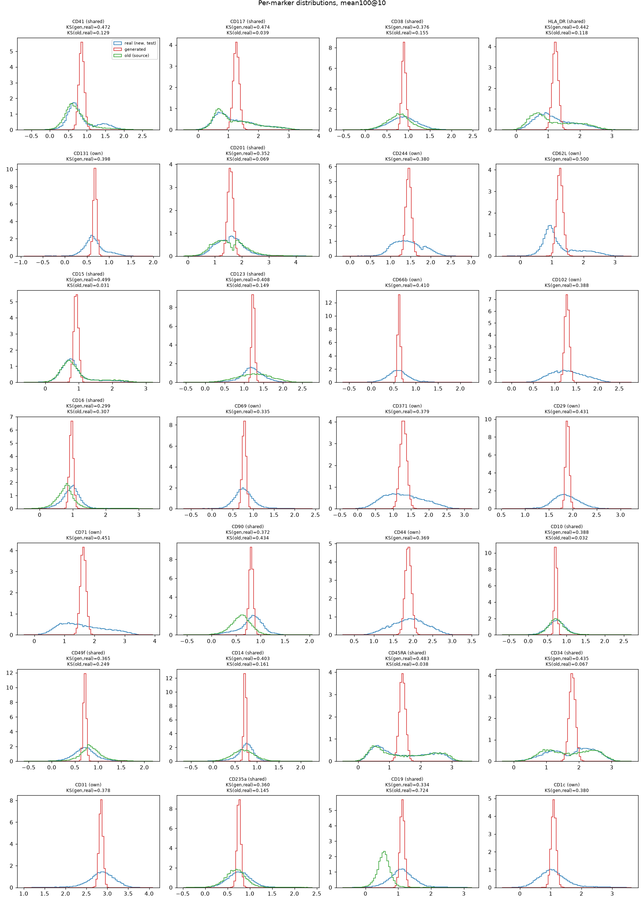
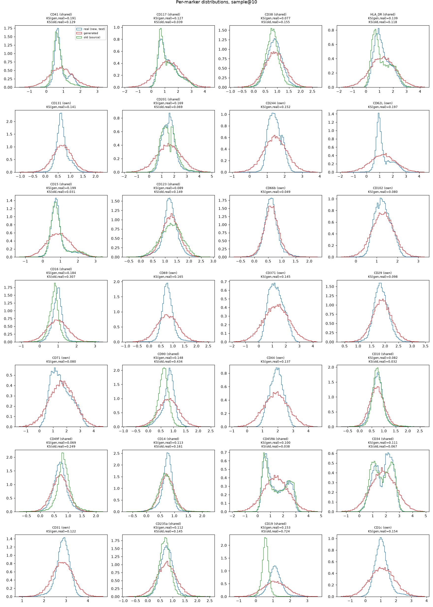
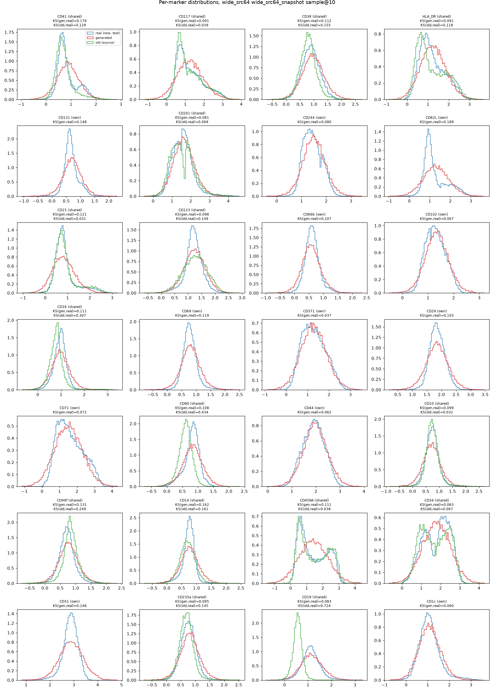
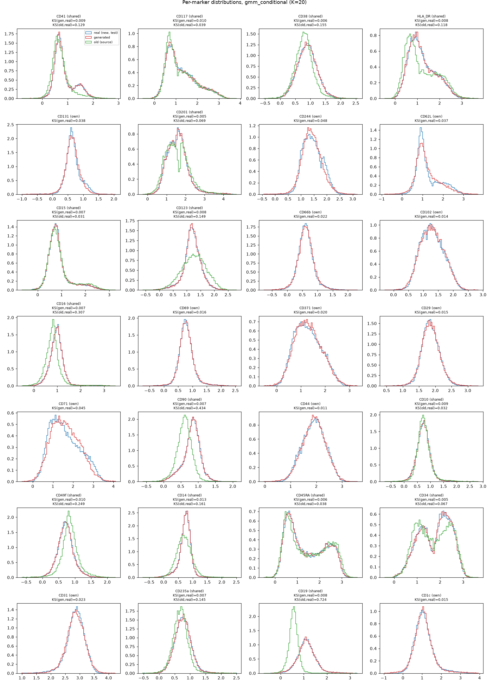
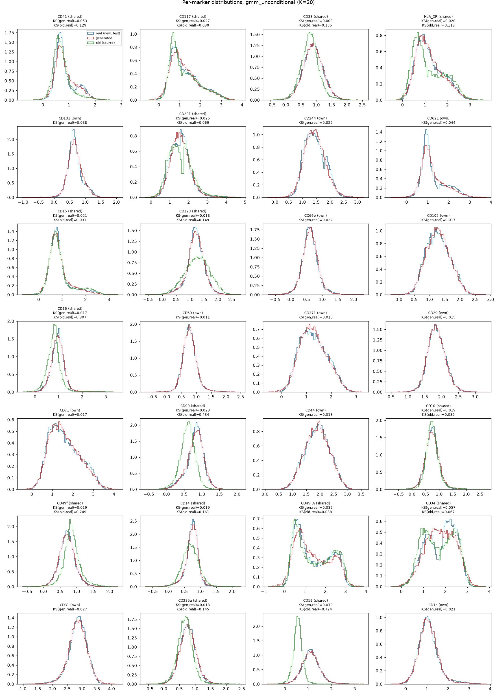
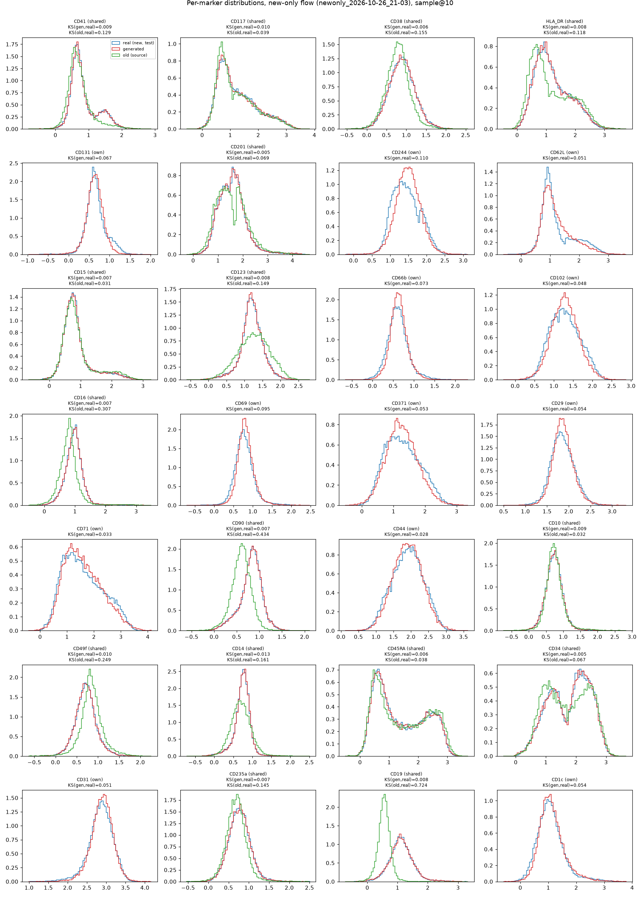

# Panel imputation: why the flow smears bimodal markers, and a GMM baseline

Data: the OH013 marrow sample measured with two flow cytometry panels, logicle transformed (`layers["logicle_trans"]`).

| | markers |
|---|---|
| old panel | 23 (16 shared + 7 old-only) |
| new panel | 28 (16 shared + 12 new-only) |

No cell is measured on both panels. The task is to give each old-panel cell its 28 new-panel markers. The new
panel's cells are split train / val / test (`split_42`, 70 / 10 / 20) and the old panel is the source.

Scripts are in [`analysis/panel_imputation/`](../analysis/panel_imputation). Each one takes a finished flowrun run
dir only to read its data config (`.hydra/config.yaml`). How to run them on the cluster: [running manual](../analysis/panel_imputation/README.md).

## 1. What the flow did wrong

Diagnosis of the existing runs (`diagnose.py`), 20k old cells against the new panel's test cells, on all 28 markers:

| run | prediction | energy distance | mean KS | Spearman (generated vs own source value, shared) |
|---|---|---|---|---|
| small model, eps 1 | mean of 100 samples (`PredictionData.X`) | 0.917 | 0.40 | ~0 |
| small model, eps 1 | one sample, 10 / 50 / 200 Euler steps | 0.197 | 0.128 | ~0 |
| wide model, eps 1 | one sample | 0.012 | | 0.05 |
| wide model + 64-d source encoder, eps 1 | one sample | 0.009 | 0.048 | 0.05 |
| wide, eps 0.1, 1500 steps | one sample | 0.019 | | 0.30 |

Three separate problems:

1. **Averaging.** `PredictionData.X` is the mean over samples. For a bimodal marker
   $p(x) = \pi\,\mathcal N(\mu_-, \sigma^2) + (1-\pi)\,\mathcal N(\mu_+, \sigma^2)$ the mean is
   $\pi\mu_- + (1-\pi)\mu_+$, which falls between the two peaks. This alone produced most of the smearing in the plots.
   Use `raw_samples`, or one sample.
2. **Capacity.** The small model could not fit the 28-d marginal (edist 0.2). The wide one fits it (0.01). ODE
   steps make no difference.
3. **The source is ignored.** Even when the marginal is right, a generated cell is barely correlated with its own
   source cell (Spearman 0.05). With entropic OT at $\varepsilon = 1$ (median-scaled cost) the coupling is almost
   independent, so the flow learns $p(\text{target})$, not $p(\text{target}\mid\text{source})$. At
   $\varepsilon = 0.1$ it does better (0.30; CD45RA 0.77, CD34 0.66). At $\varepsilon = 0.05$ Sinkhorn
   diverges and falls back every step.

Per-marker densities: real new-panel test cells (blue), generated (red), old-panel source (green).

| small model, mean of 100 samples | small model, one sample | wide + src64, one sample |
|---|---|---|
|  |  |  |

## 2. Why quantile matching on the shared markers

The 16 shared markers are the bridge between the panels. They are not read identically: other fluorochromes,
detector settings and spillover change each marker's scale. Per marker the medians differ, e.g.:

| marker | old median | new median |
|---|---|---|
| CD34 | 1.71 | 1.90 |
| CD235a | 0.69 | 0.76 |
| CD19 | 0.56 | 1.11 |

So we map each old shared marker onto the new panel's scale with the monotone map that matches the two marginals:

$$\tilde s_j = F_{\text{new},j}^{-1}\big(F_{\text{old},j}(s_j)\big)$$

$F$ is the empirical CDF; `quantile_match` interpolates over 1001 quantiles. The reference is the new panel's
train cells. In 1-d this is the optimal transport map for any convex cost, so it is the smallest change that makes
the marginals agree. Because it is monotone it keeps each cell's rank: a CD34-high cell stays CD34-high.

What it assumes: the two samples have the same marginal per marker, so every difference is technical. It cannot
fix a difference in composition. The panels were annotated separately and their cell type proportions differ
(old: Early Erythroid 28k, MPP 21k, CLP 17k; new: Cycling Progenitors 24k, MPP 12k, CLP 3k), so some of the
quantile shift is biology that we wrongly remove. It also does not touch the joint structure between markers.

## 3. The GMM baseline

### Model

On the new panel's train cells $x = (s, n)$, with $s$ the 16 shared and $n$ the 12 new-only markers, fit

$$p(x) = \sum_{k=1}^{K} \pi_k\, \mathcal N(x;\, \mu_k, \Sigma_k)$$

with full covariances (sklearn `GaussianMixture`, `reg_covar=1e-4`, 60k cells). A cytometry population is roughly a
Gaussian blob in logicle space, and a sample is a mixture of populations. That is why the marginals are bi- or
multimodal: each marker's histogram is a sum of the populations' 1-d projections.

### Conditioning

Each component's Gaussian conditional is closed form. Write

$$\mu_k = \begin{pmatrix}\mu_{k,s}\\ \mu_{k,n}\end{pmatrix},\quad
\Sigma_k = \begin{pmatrix}\Sigma_{k,ss} & \Sigma_{k,sn}\\ \Sigma_{k,ns} & \Sigma_{k,nn}\end{pmatrix}.$$

Then

$$p(n \mid s) = \sum_k r_k(s)\, \mathcal N\big(n;\; \mu_{k,n} + \Sigma_{k,ns}\Sigma_{k,ss}^{-1}(s - \mu_{k,s}),\;
\Sigma_{k,nn} - \Sigma_{k,ns}\Sigma_{k,ss}^{-1}\Sigma_{k,sn}\big)$$

$$r_k(s) = \frac{\pi_k\, \mathcal N(s;\, \mu_{k,s}, \Sigma_{k,ss})}{\sum_j \pi_j\, \mathcal N(s;\, \mu_{j,s}, \Sigma_{j,ss})}$$

$r_k(s)$ is the posterior probability that the cell belongs to population $k$, given only its shared markers.
To sample, draw $k \sim r(s)$ and then $n$ from that component's conditional Gaussian. The conditional mean is
$\sum_k r_k(s)\,\mathbb E_k[n\mid s]$. This is `gmm_conditional` in `gmm_percell.py`.

To impute an old cell: quantile-match its shared markers, keep them, and draw $n \sim p(n \mid \tilde s)$.

### Choosing K

`obs_and_k.py` sweeps $K$ with 2 seeds and scores val R² of $\mathbb E[n\mid s]$ on the new panel's val cells
(per-cell ground truth, see 4). BIC is on the fit cells.

| K | val R² | BIC | mean top responsibility |
|---|---|---|---|
| 8 | 0.468 | 363k | 0.84 |
| 12 | 0.491 | 290k | 0.82 |
| 16 | 0.501 | 258k | 0.79 |
| 20 | 0.506 | 248k | 0.77 |
| 24 | 0.511 | 247k | 0.75 |
| **28** | **0.516** | **247k** | 0.73 |
| 32 | 0.518 | 250k | 0.71 |
| 40 | 0.521 | 265k | 0.68 |

R² keeps creeping up (+0.005 from 28 to 40) while BIC is lowest at 24 to 28 and rises after. K = 28 is also close to the 23 annotated new-panel
cell types. Two components per marker would not be enough: the bimodality is per marker, but the populations live
in 28-d. The tables below used K = 20, picked by BIC from {10, 20, 30, 40} before the sweep.

The top responsibility of about 0.75 means the shared markers mostly, but not fully, identify the population.

## 4. Results

### Distribution, old cells imputed (`gmm_baseline.py`)

20k old cells, scored on all 28 markers against the new panel's test cells.

| method | energy distance | mean KS | mean KS, new-only |
|---|---|---|---|
| GMM conditional, K = 20 | **0.0045** | **0.015** | 0.025 |
| GMM unconditional (sample $p(x)$, ignore the cell) | 0.0019 | 0.024 | 0.023 |
| flow, shared recalibrated + new-only generated | 0.0095 | 0.030 | 0.060 |
| flow, all 28 generated (best, wide + src64, eps 1) | 0.009 | 0.048 | |

| GMM conditional | GMM unconditional | flow, new-only generated |
|---|---|---|
|  |  |  |

The unconditional GMM shows that distribution metrics alone cannot tell a model that uses the cell from one that
ignores it. That is why we also score per cell.

### Per cell, inside the new panel (`gmm_percell.py`, `newonly_eval.py`)

The only place with ground truth: hide the 12 new-only markers of the new panel's test cells and predict them from
their 16 shared ones. R² of the conditional mean, r of one sample against the truth, and KS of that sample.

| marker | GMM R² | kNN (30) R² | linear R² | flow R² | GMM KS | flow KS |
|---|---|---|---|---|---|---|
| CD66b | 0.243 | 0.200 | 0.158 | 0.121 | 0.022 | 0.077 |
| CD244 | 0.354 | 0.317 | 0.158 | 0.141 | 0.027 | 0.107 |
| CD29 | 0.371 | 0.352 | 0.278 | 0.303 | 0.007 | 0.056 |
| CD31 | 0.447 | 0.425 | 0.247 | 0.248 | 0.018 | 0.052 |
| CD371 | 0.477 | 0.426 | 0.254 | 0.218 | 0.021 | 0.055 |
| CD62L | 0.479 | 0.443 | 0.299 | 0.253 | 0.046 | 0.049 |
| CD69 | 0.499 | 0.352 | 0.129 | 0.068 | 0.008 | 0.094 |
| CD131 | 0.587 | 0.563 | 0.411 | 0.248 | 0.018 | 0.065 |
| CD44 | 0.601 | 0.550 | 0.436 | 0.380 | 0.014 | 0.029 |
| CD102 | 0.608 | 0.573 | 0.449 | 0.450 | 0.016 | 0.051 |
| CD1c | 0.716 | 0.643 | 0.479 | 0.275 | 0.015 | 0.052 |
| CD71 | 0.719 | 0.648 | 0.640 | 0.448 | 0.024 | 0.027 |
| **mean** | **0.508** | 0.458 | 0.328 | 0.263 | **0.020** | 0.059 |

GMM K = 20. Flow: wide, fused GW, eps 0.1, 6k steps, trained only to generate the 12 new-only markers from the
recalibrated shared ones (`prep_newonly.py`, `newonly_eval.py`). r of one sample: GMM 0.516, flow 0.228.

The GMM is about twice as good per cell and three times closer per marker. It is fit in minutes on CPU.

## 5. Why the GMM wins, and what to try with the flow

The GMM learns $p(n \mid s)$ from pairs measured on the **same cell**: every new-panel cell has both $s$ and $n$.
The OT flow learns from pairs between **different cells**: an old cell coupled to new cells with similar shared
markers. That gives a blurred neighbour average under a balanced-mass constraint, and it is hurt by the composition
difference. Every problem in section 1 is a problem of that coupling, not of the flow.

Once the shared markers are kept and only the new-only ones are generated, the input is $s$ and the output is $n$.
The new panel already holds about 108k exact $(s, n)$ examples, so the OT pairing is not needed. This is how
backbone imputation is usually framed in cytometry (Infinity Flow, CyTOFmerge).

Next runs:

- **A, supervised**: train the flow on new-panel cells only, target `new_only`, condition on the shared markers,
  independent coupling. The same information as the GMM, so it compares the model classes directly.
- **B, unbalanced OT**: source the old panel, unbalanced Sinkhorn on the shared markers (`reg 0.1`,
  `reg_m` 1 and 10), so cell types that differ in proportion are not forced to match. This measures what the
  unpaired route costs.

Score both by val R² against the K = 28 GMM (0.516). Report test once, at the end.

## Caveats

- The per-cell test is an upper bound for old cells: it skips the panel shift that quantile matching only partly
  removes.
- The split is random within one sample, so val and test cells share donors and runs with train.
- The val set has been looked at several times (K sweep, flow checkpoints). Test only for the final table.
- The 7 old-only markers are not used by any method here.
